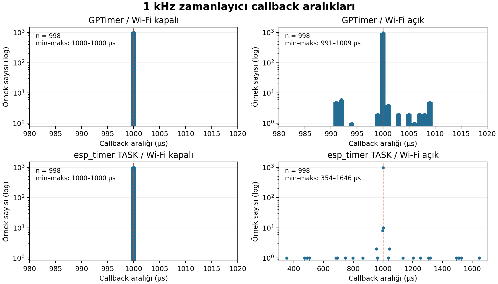

# Laboratuvar 2 — ESP32 GPIO ve Zamanlayıcılar

İleri Gömülü Sistemler dersi kapsamında GPIO register erişimi, kesmeler, yazılımsal debounce ve zamanlayıcı ölçümleri.

**Hazırlayan:** İbrahim Kaan Dalğar  


## Donanım ve yazılım

- Standart ESP32, 160 MHz
- ESP-IDF v6.1
- GPIO4 üzerinde seri dirençli LED
- GPIO0 üzerindeki BOOT düğmesi
- Windows ve ESP-IDF terminali

LED bağlantısı: **GPIO4 → seri direnç → LED anot; LED katot → GND.**

Sunumdaki ESP32-S3 yerine standart ESP32 kullanılmıştır. Register tanımları kullanılan hedefe göre uyarlanmıştır.

## Deneyler

1. GPIO4, `gpio_reset_pin()` kullanılmadan doğrudan register üzerinden yapılandırıldı. LED beş kez yakılıp söndürüldü. Ardından `gpio_config()` çağrıldı; incelenen register değerleri değişmedi.
2. `gpio_set_level()`, GPIO yapısı ve `REG_WRITE()` yöntemleri karşılaştırıldı. Her yöntem için 100.000 HIGH–LOW çifti üç kez ölçüldü. Derlenmiş komutlar `objdump` ile incelendi.
3. BOOT düğmesinin düşen kenar kesmeleri zaman damgasıyla kuyruğa aktarıldı. Görev içinde son kabulden itibaren 50 ms'lik yazılımsal filtre uygulandı. 20 basışta 20 olay kabul edildi; kuyruk kaybı veya ek sıçrama kesmesi görülmedi. Filtrenin sıçrama bastırma etkisi bu denemede gösterilemedi.
4. GPTimer ve `esp_timer` TASK, 1 kHz hedefle Wi-Fi kapalı ve açık koşullarda karşılaştırıldı.

## GPIO yapılandırma sonuçları

| Register veya durum | Doğrudan ayar | gpio_config sonrası |
|---|---|---|
| IO_MUX GPIO4 | `0x00002800` | `0x00002800` |
| RTC PAD0 | `0x42000000` | `0x42000000` |
| GPIO PIN4 | `0x00000000` | `0x00000000` |
| GPIO OUT SEL | `0x00000500` | `0x00000500` |
| GPIO4 ENABLE / OUT | `1 / 0` | `1 / 0` |

Karşılaştırma doğrudan yapılandırmadan sonra yapılan `gpio_config()` çağrısının öncesine ve sonrasına aittir.

## GPIO hız sonuçları

| Yöntem | Süre aralığı (µs) | Hesaplanan frekans |
|---|---:|---:|
| gpio_set_level | 74431–74448 | Yaklaşık 1,34 MHz |
| GPIO yapısı | 12509–12517 | Yaklaşık 7,99 MHz |
| REG_WRITE | 12509 | Yaklaşık 7,99 MHz |

Bir periyot bir HIGH ve bir LOW yazmadan oluşur. Frekans, periyot sayısının toplam yazılım süresine bölünmesiyle hesaplanmıştır.

GPIO yapısı ve `REG_WRITE()` aynı set/clear register adreslerine (`0x3ff44008`, `0x3ff4400c`) erişir. API döngüsünde her periyotta iki `call8` fonksiyon çağrısı görülür. Doğrudan erişim yöntemleri ölçülen koşullarda yaklaşık 5,95 kat hızlıdır.

## Zamanlayıcı sonuçları

Aşağıdaki değerler **1000 örneklik terminal özetlerinden** alınmıştır.

| Yöntem | Wi-Fi | Minimum (µs) | Maksimum (µs) | Ortalama (µs) | Tepe-tepe (µs) |
|---|---|---:|---:|---:|---:|
| GPTimer | Kapalı | 1000 | 1000 | 1000,000 | 0 |
| GPTimer | Açık | 988 | 1009 | 999,988 | 21 |
| esp_timer TASK | Kapalı | 952 | 1000 | 999,952 | 48 |
| esp_timer TASK | Açık | 354 | 1646 | 999,948 | 1292 |

GPTimer callback'i ISR bağlamında, `esp_timer` callback'i `ESP_TIMER_TASK` bağlamında çalıştırılmıştır. Wi-Fi açık ölçümlerde istasyon ağa bağlanmış, güç tasarrufu kapatılmış ve iki saniye beklenmiştir. Ek ağ trafiği üretilmemiştir. Wi-Fi kapalı ölçümlerde Wi-Fi başlatılmamıştır.

### Veri kapsamı

Bölüm 4 CSV dosyaları aktarılırken başlık ve ilk iki ölçüm satırı eksik kalmıştır. Her dosyada 3–1000 numaralı **998 gerçek ölçüm** vardır. Eksik değerler tahmin edilerek doldurulmamıştır. Orijinal CSV'ler başlıksızdır; sütun sırası `yontem,wifi,ornek,periyot_us` şeklindedir.

Histogramlar 998 örneğe, yukarıdaki tablo ise terminaldeki 1000 örneklik özetlere dayanır. Bu nedenle bazı uç değerler farklıdır. İlk iki örneğin eksikliği başlangıç etkilerinin görünümünü değiştirebilir.

| CSV alt kümesi | Minimum (µs) | Maksimum (µs) | Ortalama (µs) | Tepe-tepe (µs) |
|---|---:|---:|---:|---:|
| GPTimer / Wi-Fi kapalı | 1000 | 1000 | 1000,000 | 0 |
| GPTimer / Wi-Fi açık | 991 | 1009 | 1000,000 | 18 |
| esp_timer TASK / Wi-Fi kapalı | 1000 | 1000 | 1000,000 | 0 |
| esp_timer TASK / Wi-Fi açık | 354 | 1646 | 1000,000 | 1292 |



Her panel 998 örnek içerir. Sınıf genişliği 1 µs, düşey eksen logaritmiktir. `esp_timer` Wi-Fi açık panelinin yatay ekseni daha geniştir.

## Ölçüm sınırları

- USB lojik analizör kullanılmamıştır. GPIO frekansları fiziksel dalga şeklinden değil, toplam yazılım süresinden hesaplanmıştır.
- Zamanlayıcı ölçümleri callback zamanları arasındaki farklardır; fiziksel GPIO dalga şekli veya yalnız donanım zamanlayıcı hatası ölçümü değildir.
- 0 µs değişim, kullanılan mikrosaniye çözünürlüğünde fark görülmediğini belirtir.
- Her zamanlayıcı koşulu için tek kısa kayıt alınmıştır. Sonuçlar genel maksimum performans veya gerçek zaman garantisi değildir.
- Ortalama periyodun 1000 µs'ye yakın olması her callback'in eşit aralıklarla çalıştığını göstermez.

## Güncel projeyi çalıştırma

Güncel `main.c`, **GPTimer ve Wi-Fi açık** deneyini çalıştırır.

1. `lab2_gpio/main/wifi_secrets.example.h` dosyasını aynı klasöre `wifi_secrets.h` adıyla kopyalayın.
2. Ağ adı ve parolayı yerel dosyada düzenleyin. `wifi_secrets.h` Git tarafından dışarıda tutulur.
3. ESP-IDF terminalinde `lab2_gpio` klasörüne girip çalıştırın:

```bash
idf.py build
idf.py -p COM7 flash monitor
```

`COM7` yerine kartın bağlı olduğu portu kullanın. Monitörden çıkmak için **Ctrl + ]** tuşlarını kullanın.

### Diğer bölümleri çalıştırma

İlgili kaynak kopyasının içeriğini `main/main.c` dosyasına aktarın ve `main/CMakeLists.txt` bağımlılıklarını aşağıdaki tabloya göre ayarlayın. Kaynak yedeklerini koruyun.

| Bölüm | results içindeki kaynak | REQUIRES bağımlılıkları |
|---|---|---|
| 1 — Register yapılandırma | `bolum1_main.c` | `esp_driver_gpio` |
| 2 — Hız karşılaştırması | `bolum2_main.c` | `esp_driver_gpio esp_timer` |
| 3 — BOOT kesmesi | `bolum3_main.c` | `esp_driver_gpio esp_timer` |
| 4 — GPTimer, Wi-Fi kapalı | `bolum4_gptimer_main.c` | `esp_driver_gptimer esp_timer` |
| 4 — esp_timer, Wi-Fi kapalı | `bolum4_esp_timer_main.c` | `esp_timer` |
| 4 — esp_timer, Wi-Fi açık | `bolum4_esp_timer_wifi_on_main.c` | `esp_timer esp_wifi esp_event esp_netif nvs_flash` |
| 4 — GPTimer, Wi-Fi açık | `bolum4_gptimer_wifi_on_main.c` | `esp_driver_gptimer esp_timer esp_wifi esp_event esp_netif nvs_flash` |

`main/CMakeLists.txt` dosyasındaki kaynak kaydı `SRCS "main.c"` olarak kalmalıdır. Wi-Fi açık bölümler `wifi_setup.h` ve yerel `wifi_secrets.h` dosyasını kullanır.

## Dosyalar

- `lab2_gpio/`: Güncel ESP-IDF projesi ve Wi-Fi yardımcı kodu
- `results/`: Bölüm kaynakları, ölçümler ve objdump çıktısı
- `images/`: Zamanlayıcı histogramları
- `rapor/`: İki sayfalık deney raporu

[Deney raporunu aç](rapor/Lab2_Deney_Raporu.pdf)

## Kaynaklar

- Dersin Hafta 2 ESP32 sunumu
- [Espressif ESP-IDF v6.1 belgeleri](https://docs.espressif.com/projects/esp-idf/en/v6.1/esp32/api-reference/)
- Deneyde kaydedilen terminal çıktıları, CSV ölçümleri ve objdump dökümü
